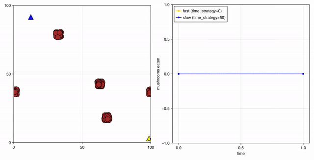
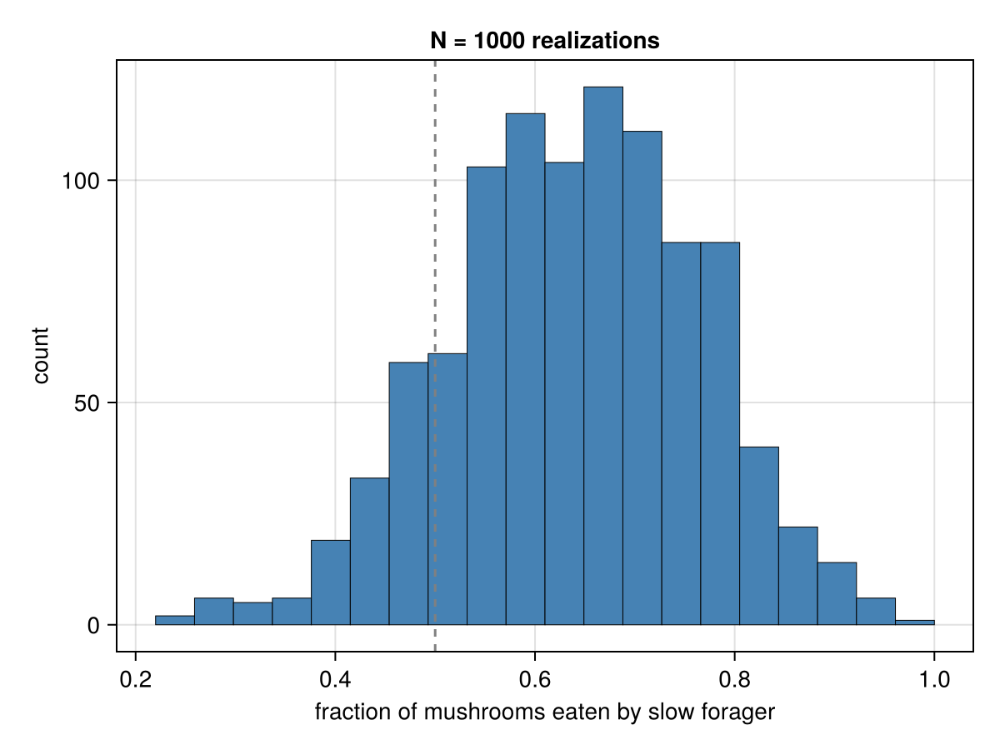
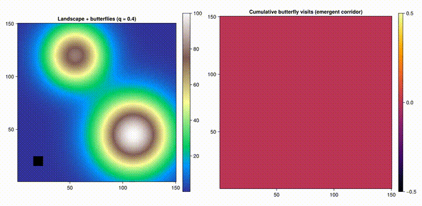
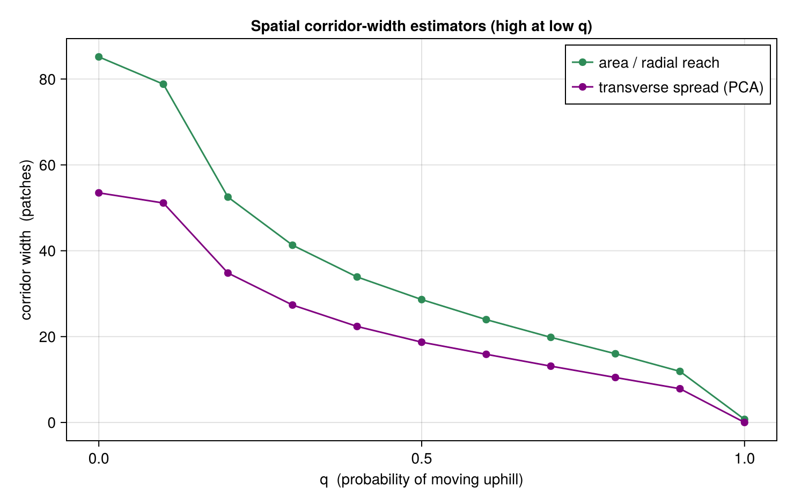
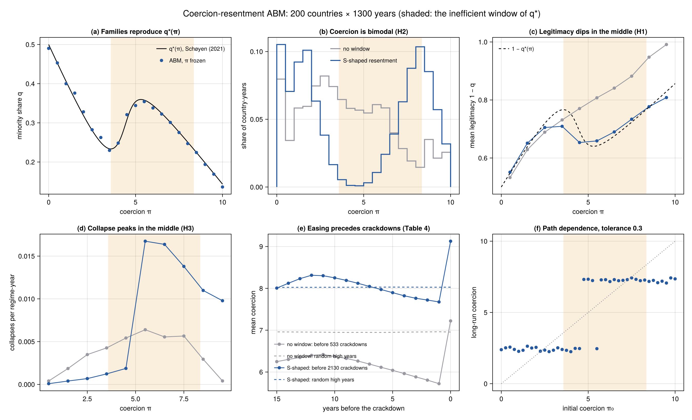
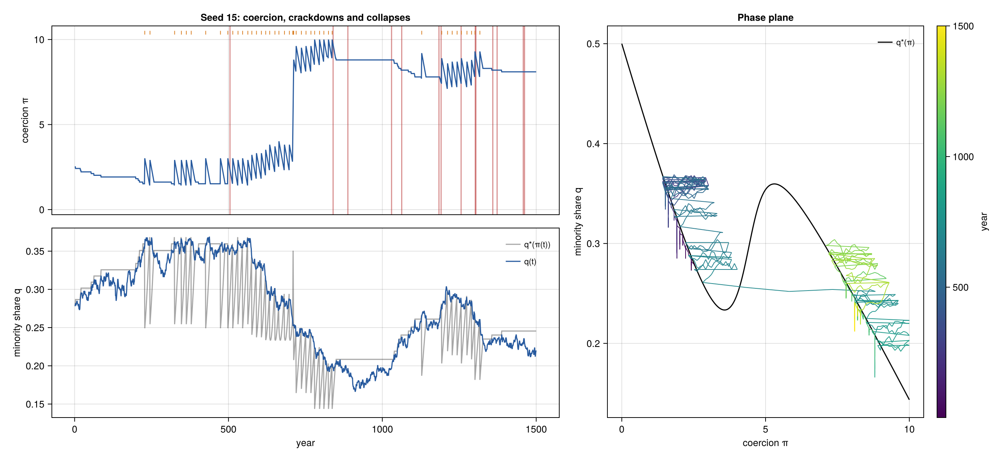

# Mushroom Hunt — an Area-Restricted Search ABM

An [Agents.jl](https://juliadynamics.github.io/Agents.jl/stable/) agent-based model
exploring **area-restricted search** (a.k.a. *intermittent* or *two-mode* search):
the foraging strategy where an animal searches locally after finding food and
travels in straight lines when it hasn't found any for a while.



## The model

**Foragers** (triangles) move at constant speed through a 2D periodic space,
eating **mushrooms** (brown circles) that come within their sight radius.
Mushrooms are spawned in a few dense **clusters**, so food is patchy rather than
uniform. Each forager switches between two movement modes depending on how long
it has gone without eating (`time_since_last_found` vs. its `time_strategy`
threshold):

- **Foraging mode** (recently fed): large random turns (±π/2) — stay and sweep
  the local patch.
- **Searching mode** (hungry a while): small turns (±π/16) — travel nearly
  straight to reach a new area.

A forager's `time_strategy` sets how long it lingers after a find before giving
up and relocating. The experiment pits a **fast** forager (`time_strategy = 0`,
never lingers) against a **slow** one (`time_strategy = 50`, does
area-restricted search) competing for the same mushrooms.

## Experiment

Across many random realizations we record each forager's **share** of the
mushrooms eaten, and histogram the slow forager's fraction. A value of 0.5 means
the two strategies tie; above 0.5 means area-restricted search wins.



Whether area-restricted search pays off depends on the environment: it helps most
when patches are **rich enough to chain finds** (keeping the forager in foraging
mode), and provides little benefit when patches are sparse and tiny, where both
foragers behave like straight-line searchers most of the time.

## Butterfly corridors — a second model

A separate model (Pe'er et al. 2005) explores **virtual corridors**: narrow paths
that many butterflies follow even though nothing about the habitat there is
special. Each butterfly moves over an elevation landscape, stepping to its highest
neighbouring patch with probability `q` (hilltopping) and to a random neighbour
otherwise. The corridor is *emergent* — it appears in the cumulative visitation
map (right) purely from the interplay of this simple rule with the topography.
See [`butterfly_corridor.md`](butterfly_corridor.md) for the full model summary.



How sharp is the corridor? Releasing all butterflies from a single patch and
measuring the width of the trail they leave — either as `area / radial reach` or
as the transverse spread of the visited patches (PCA minor axis) — shows the
corridor tightening monotonically as the uphill bias `q` grows: a diffuse, near-
random cloud at low `q` collapses to a single deterministic track at `q = 1`.



## Business investors — a third model

A toy economy on a **19×19 grid of businesses**, each with a fixed **profit** `P`
and **risk** `F`. Every step, **investors** (white dots, at most one per business)
hop to the best business they can see — maximising the utility
`U = (W + T·P)(1 − F)^T` — then bank its profit, except that with probability `F`
their wealth is wiped to zero. Investors drift toward high-profit, low-risk
businesses purely from this local rule. See
[`models/The business investor model.md`](models/The%20business%20investor%20model.md)
for the full description.


The ensemble experiment sweeps the investors' **sensing radius** (how far they can
see, 0–5) across many realizations. Most of the payoff comes from being able to
move at all (`r = 0 → 1`); extra vision beyond that mainly buys **lower risk**,
with strongly diminishing returns.


## Layout

- [`src/MushroomHunt.jl`](src/MushroomHunt.jl) — the model: agent types, the
  stepping rule, and `initialize` (plotting-agnostic, all parameters are keyword
  arguments so it is reusable for scans and ensembles).
- [`scripts/mushroom_single_run.jl`](scripts/mushroom_single_run.jl) — one
  realization rendered to a video (space + live mushrooms-eaten panel).
- [`scripts/mushroom_ensemble.jl`](scripts/mushroom_ensemble.jl) — ensemble over
  many seeds, producing the histogram above.
- [`src/ButterflyCorridor.jl`](src/ButterflyCorridor.jl) — the butterfly-corridor
  model: the `Butterfly` agent, the hilltopping/random step rule, and `initialize`.
- [`scripts/butterfly_single_run.jl`](scripts/butterfly_single_run.jl) — one
  realization rendered to the corridor video/gif above.
- [`scripts/butterfly_q_sweep.jl`](scripts/butterfly_q_sweep.jl) — sweeps `q` and
  plots the spatial corridor-width estimators above (no single-run visualization).
- [`src/BusinessInvestor.jl`](src/BusinessInvestor.jl) — the business-investor
  model: the `Investor` agent, the reposition + accounting steps, and `initialize`.
- [`scripts/business_investor_single_run.jl`](scripts/business_investor_single_run.jl)
  — one realization rendered to the gif above.
- [`scripts/business_investor_ensemble.jl`](scripts/business_investor_ensemble.jl)
  — sweeps the sensing radius over many seeds, producing the plot above.

## Running

```julia
using Pkg; Pkg.activate(".")   # from the repo root
include("scripts/mushroom_single_run.jl")           # generates mushroom_hunt.mp4
include("scripts/mushroom_ensemble.jl")             # generates fraction_slow_hist.png
include("scripts/business_investor_single_run.jl")  # generates business_investor.mp4
include("scripts/business_investor_ensemble.jl")    # generates business_investor_ensemble.png
```

## References

- S. Benhamou, *Efficiency of area-concentrated searching behaviour in a
  continuous patchy environment*, J. Theor. Biol. **159**, 67–81 (1992).
- O. Bénichou, C. Loverdo, M. Moreau, R. Voituriez, *Intermittent search
  strategies*, Rev. Mod. Phys. **83**, 81 (2011).

## Coercion resentment — a fourth model

An agent-based version of Schøyen (2021), the cultural-transmission model behind
Schøyen, Sirnes and Andersen (2026). Families pass an identity to their children.
Coercion penalises the minority identity but breeds an S-shaped resentment, which
opens a window where more coercion grows the minority. One regime per country
eases while the minority isn't growing, cracks down when it is growing and too
big, and collapses with the size of the resentful minority. See
[`models/coercion_resentment.md`](models/coercion_resentment.md).

Without being told where the window is, the regimes avoid it, so coercion comes
out bimodal. Legitimacy dips just above the window's peak, but not over the whole
window as the paper states. A control without a window (grey) shows neither. It
does show the mid-scale collapse peak and the easing before crackdowns, so those
two facts do not test resentment. The minimal version (no collapse, one
tolerance, six free parameters) is described at the end of the model file.




