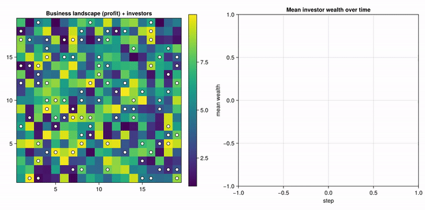
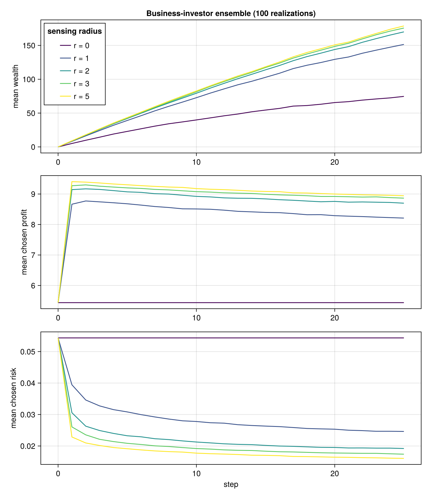

#abm

# Business Investor Model v0 — Omniscient Risk

The **implemented** version of the model, in
[`src/BusinessInvestor.jl`](../src/BusinessInvestor.jl). Investors read every
business's true failure rate directly. Its successor — in
[`The business investor model.md`](The%20business%20investor%20model.md) — hides
that number and makes investors infer it; this document is the control that
version is measured against.

## Overview

Investors move over a grid of **businesses**, each offering a fixed profit
(possibly a loss) and a fixed risk of ruin. Both are **fully observable** within
the investor's sensing radius. Each step, investors relocate to the best
risk-adjusted business they can see, then collect profit and face the chance of
being wiped out.

## Entities and State

| Entity | State |
|--------|-------|
| **Business** (patch) | `profit` *P* (fixed, may be negative), `risk` *F* (fixed) — both visible to agents |
| **Investor** (agent) | `pos`, `wealth` *W* ≥ 0 |

- **19 × 19** grid, **non-periodic** (real edges, not a torus).
- **At most one investor per business.**
- Businesses never change; *P* and *F* are set at initialization.
- Investors have no memory and no internal state beyond wealth.

## Process

Each step runs two phases.

**1. Repositioning** (`agent_step!`, random order). The investor evaluates the
*empty* patches within `sensing_radius` (Chebyshev distance; `r = 1` is the Moore
neighbourhood) and moves to the highest-utility one, **only if it strictly beats
staying put**. Ties broken at random. Order matters only through exclusion: an
investor that moves first frees its old patch and blocks its new one.

**2. Accounting** (`model_step!`, after all moves). For each investor on patch *p*:

- `W ← W + P(p)` — a negative *P* is a loss.
- If `W < 0`, the investor **goes bankrupt**: `W` resets to 0 and it keeps
  playing. Debts are never carried forward.
- Independently, **with probability `F(p)`** a ruin event wipes `W` to zero.

Investors are independent here, so order is irrelevant.

## Utility

$$U = (W + T\,P)\,(1 - F)^{T}, \qquad T = 5$$

This is *exactly* the expected wealth after `T` steps, because both ruin and
bankruptcy reset to zero: survive with probability `(1 − F)^T` and hold
`W + T·P`, otherwise hold `0`. `T` is the only forecast in the model — investors
do not simulate the future.

One quirk, left in deliberately: when `W + T·P < 0` the formula prefers *higher*
risk. An investor facing certain losses would rather be wiped out. That is a
genuine consequence of the reset-to-zero rule, not a special case.

## Parameters

| Parameter | Meaning | Default |
|-----------|---------|---------|
| `dims` | Grid size in businesses | `(19, 19)` |
| `n_investors` | Number of investors | `100` (single run), `10` (ensemble) |
| `T` | Planning horizon in *U* | `5` |
| `sensing_radius` | Chebyshev radius an investor can see and move to | `1` (`0` = frozen) |
| `profit_range` | Uniform range for each *P* | `(-5.0, 10.0)` |
| `risk_range` | Uniform range for each *F* | `(0.01, 0.1)` |
| `nsteps` | Run length | `25` |
| `seed` | RNG seed | `1234` |

**Initialization.** Each business draws `P ~ U(-5, 10)` and `F ~ U(0.01, 0.1)`
independently — landscape mean profit `2.5`, mean risk `0.055`, and **1/3 of
businesses loss-making**. Investors start on distinct random empty patches with
`W = 0`.

## Results

### Single run

100 investors, `r = 1`, 25 steps ([`scripts/business_investor_single_run.jl`](../scripts/business_investor_single_run.jl)).
Investors (white) over the profit landscape; brighter is more profitable.

Investors leave the dark loss-making regions within a step or two and pack onto
the bright ridges, then largely stop moving. The population visibly sorts itself
onto the profitable third of the landscape, with occasional wealth collapses as
ruin events fire.

### Ensemble scan over sensing radius

100 landscapes × 10 investors × 25 steps, for `r ∈ {0, 1, 2, 3, 5}`
([`scripts/business_investor_ensemble.jl`](../scripts/business_investor_ensemble.jl)).

| `r` | final mean wealth | chosen *P* (step 1 → 25) | final chosen *F* |
|-----|------------------|--------------------------|------------------|
| 0 | 44.9 | 2.4 → 2.4 | 0.0543 |
| 1 | 136.0 | 8.08 → 7.75 | 0.0300 |
| 2 | 157.7 | 8.85 → 8.30 | 0.0218 |
| 3 | 165.7 | 9.09 → 8.53 | 0.0193 |
| 5 | 169.4 | 9.24 → 8.66 | 0.0180 |

Three findings.

**`r = 0` recovers the landscape.** Frozen investors sit where they were dropped,
so chosen profit `2.4` and chosen risk `0.0543` just reproduce the landscape
means (`2.5`, `0.055`). A useful sanity check on the whole pipeline.

**Vision pays, with sharp diminishing returns.** Going from `r = 0` to `r = 1`
triples wealth (44.9 → 136.0). Every further increase adds far less, and `r = 3`
to `r = 5` adds ~2 %. Local search captures almost all of the available
advantage.

**Risk aversion emerges without a rule for it.** Chosen profit jumps immediately,
then drifts slightly *down* over the run, while chosen risk falls **steadily
throughout** — at `r = 1`, from the landscape's `0.055` to `0.030`. Investors
trade profit away for safety, and nothing in the model tells them to.

The mechanism is in the utility function. Comparing two patches,

$$\frac{U_B}{U_A} = \underbrace{\frac{W + T P_B}{W + T P_A}}_{\to\,1 \text{ as } W \text{ grows}} \times \underbrace{\left(\frac{1 - F_B}{1 - F_A}\right)^{T}}_{\text{constant in } W}$$

The profit term is additive in `W` and the risk term multiplicative, so as wealth
accumulates the profit ratio compresses toward 1 while the survival ratio keeps
its full weight. **A rich investor has more to lose, so the same investor becomes
risk-averse simply by getting richer.** The downward drift in chosen profit is
the visible price of that shift.

## Limitations — what motivated v1

Risk selection here depends entirely on investors being *handed* `F` for every
business in view. That is the strongest possible informational assumption, and it
is doing all the work behind the headline result: risk aversion requires
*comparing* the risks of businesses the investor has never occupied.

The successor model removes exactly that one assumption — `F` becomes hidden and
must be inferred from observed failures — and asks how much of the above
survives. The answer turns out to hinge less on the quality of what investors can
learn than on whether they can learn anything *comparable* across candidates.
